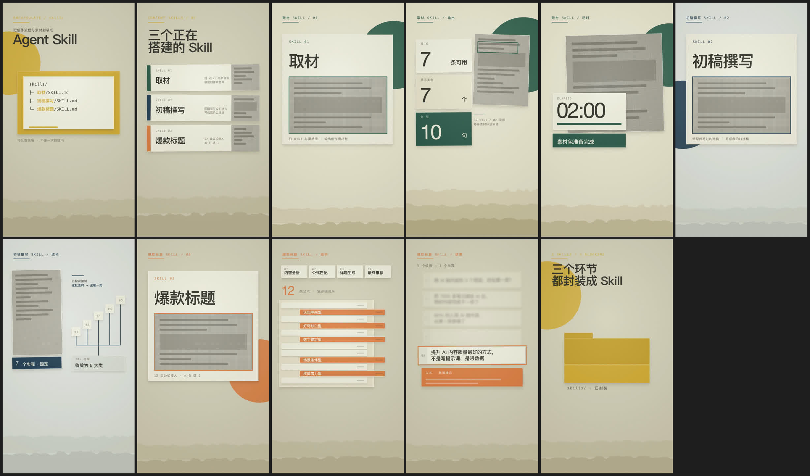

# yy-editorial-broll

半调纸拼贴风信息动画 Agent Skill。给一份口播逐字稿，AI 帮你挑出适合做成信息动画的段落，经三道确认门后，产出默认 1920×1080、H.264、无音轨的 `-SILENT.mp4` 动画——纯 HTML/CSS/GSAP 本机渲染（[HyperFrames](https://github.com/heygen-com/hyperframes)），**不调用任何图片生成模型**。

*Editorial halftone paper-collage info-graphic animations from your voiceover script, rendered locally with HTML/CSS/GSAP — no image-generation models involved. English intro [below](#english).*

## 效果

| 抽屉抽出 | 数字锚定 | 推焦收敛 | 三联卡翻面 |
|---|---|---|---|
|  |  |  |  |

> 历史演示仅作视觉风格参考，不定义现行交付规范。当前默认直接渲染 30fps 无音轨母版，只有明确要求听声音设计时才另做拟音预览；演示中的制作标签不允许进入新成片。

一次口播视频的 11 条末帧（每条动画的收帧就是一张可读海报）：



## 它做什么

从逐字稿里挑出"讲信息"的段落——数字冲击、流程结构、清单收敛、对比翻转、结果高光——做成同一视觉家族的信息图动画：米色纸场、卡纸剪片、单一点色、半调截图、stop-motion 定格。

工作流是三道确认门，每道门停下来等你确认，不跳门：

```text
Gate 1  选段 + 主动效分配 → 确认名单
Gate 2  静态样帧（headless Chrome 截图 + 拼图）→ 确认构图
Gate 3  HyperFrames 无音轨动画 + viewer-clean / 技术 QA → 交付 mp4
```

风格上的硬规则（详见 [references/style-system.md](references/style-system.md)）：

- 纸场底不用渐变；一件信息 = 一张卡纸剪片
- 一帧只有一处点色批注 + 一个出画大色块
- 默认 1920×1080 是横屏 16:9；1080×1920 是竖屏 9:16，仅明确指定时使用。安全区按「明确 item/project 要求 → approved visual brief → 上方 2/3 / 底部 1/3 保守 fallback」确定。横屏 y ≤ 720 / bottom 360px 仅是 fallback；若指定 bottom 180px，则可用内容区到 y=900，不强制额外留白。安全区不显示标签或 guides
- 真实截图过半调处理；没拿到截图前用抽象灰条占位，**绝不画假界面**
- 屏幕事实来自逐字稿，保留已批准 brief 明确要求的观众叙事标签，不替内容编数据

动效全部对齐 10fps 定格网格（`steps()` easing），八种主动效全片不重复（详见 [references/motion-grammar.md](references/motion-grammar.md)）。

## 成片生产合同

Authoring annotations are not production content. Final renders must be viewer-clean.

Default delivery is a silent editing master. Audio-bearing previews are opt-in only.

[production.md](references/production.md) 是渲染与验收入口：检查实际首帧、运动帧、末帧（推荐 contact sheet）中的制作 ID、时间 / 时长、安全区标注和 debug 文字；保留批准的叙事文字。ffprobe 核实 H.264、请求尺寸 / fps / 精确时长 / 帧数、yuv420p、audio stream count = 0，任一失败须修复并重渲染。默认不加音频 cue、不生成 sfx.wav / AAC、不先渲有声片再剥离。

每条交付 `prompt.txt`、`source/` 或等效源、`first-frame.png`、`last-frame.png`、`qa/` 或 QA 记录，以及 `<ASSET-ID>-<descriptive-name>-SILENT.mp4`。不默认创建冗余预览 MP4。

## 安装

这是一个 [Agent Skill](https://docs.claude.com/en/docs/claude-code/skills)（SKILL.md 格式），以下为 Codex 安装方式：

```bash
git clone https://github.com/YYWang316/yy-editorial-broll.git ~/.codex/skills/yy-editorial-broll
```

首次使用先自检环境：

```bash
~/.codex/skills/yy-editorial-broll/scripts/check_setup.sh
```

依赖：Node ≥ 22、Chrome（headless 截样帧）、ffmpeg/ffprobe。渲染器 `hyperframes@0.7.56` 首次 `npx` 时自动下载。

## 使用

对 Codex 说：

- 「拼贴信息动画：这是我下期视频的逐字稿……」（全流程挑段）
- 「用 yy-editorial-broll 把这段做成信息动画，就一条」（指定段落直出）

不适合的段落它会拦下来：界面操作演示归录屏、情绪独白归实拍或角色动画，不硬做。

## 仓库结构

```
SKILL.md                  # 主流程：三道门 + 色本 + 写作纪律
references/
├── style-system.md       # 风格系统：纸场/剪片/点色/半调/撕边/布局
├── motion-grammar.md     # 动效语法：定格网格 + 八种主动效 + 按需声音预览
└── production.md         # 渲染环境、项目结构、QA 检查单
assets/
├── collage.css           # 全部风格类与变量（纸纤维/网点/撕边/卡纸/半调）
├── gsap.min.js           # 本地 GSAP（渲染期无网络请求）
└── sfx/                  # 仅显式声音预览使用；默认不复制 / 混入成片
scripts/
├── check_setup.sh        # 环境自检
└── new_project.sh        # 一键建 HyperFrames 项目（assets 自包含拷入）
evals/evals.json          # 行为评测
demo/                     # README 演示素材
```

## English

**yy-editorial-broll** is an Agent Skill (SKILL.md format, works with Claude Code) that turns segments of a voiceover script into editorial halftone paper-collage info-graphic animations: beige paper field, cut-paper cards, one accent color per frame, halftone screenshots, stop-motion easing. Default output is a 1920×1080 H.264 silent editing master with zero audio streams, rendered locally via [HyperFrames](https://github.com/heygen-com/hyperframes) from pure HTML/CSS/GSAP — no image-generation models.

The workflow has three confirmation gates: segment selection (which lines deserve an animation, each assigned a unique hero motion), static hero frames (headless-Chrome screenshots for approval), then silent animation + viewer-clean and technical QA. Hard rules include: screen facts come from the script and explicitly approved narrative labels are preserved (blank placeholder cards otherwise), no fake UI is ever drawn for missing screenshots, and every animation ends exactly on its approved hero frame.

The skill's instructions and trigger phrases are written in Chinese; the visual system works for any language, though layouts are tuned for CJK-density text.

Requirements: Node ≥ 22, Chrome, ffmpeg. Run `scripts/check_setup.sh` first. SFX sourced from [Mixkit](https://mixkit.co/) (royalty-free, commercial use OK).

Based on [gbro-collage-info](https://github.com/pyang5166/gbro-collage-info), tailored by YY for a landscape YouTube B-roll workflow.

## License

MIT © 狗哥笔记
